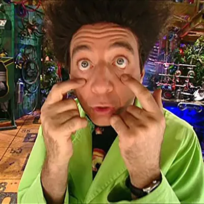

# Mi mundo de Beakman

<p align="center">
  
  
  
  
</p>

<p align="center"><strong>Cuatro tutores de IA para 1º y 2º de la ESO que no hacen los deberes: ayudan a entenderlos.</strong><br>
Historia, Matemáticas, Ciencias y Lengua, como conector de Claude.</p>

<p align="center"><a href="https://icalvete.github.io/beakman-mcp/">Web</a> · <a href="https://icalvete.github.io/beakman-mcp/guia/usarlo.html">Cómo se usa</a> · <a href="https://icalvete.github.io/beakman-mcp/guia/montar-el-tuyo.html">Monta el tuyo</a></p>

## Por qué

Con un chat de IA cualquiera, un estudiante pega el ejercicio, copia la solución y no aprende nada. Lo peor es la costumbre de no pensar.

Beakman está instruido para lo contrario:

- **Guía, no resuelve.** Pregunta qué has probado, da una pista y espera a que lo intentes.
- **Entender antes que memorizar.** Primero una imagen mental o una situación cotidiana, luego la idea y al final los nombres, las fechas o las fórmulas.
- **El error es parte de aprender.** Nunca dice que algo es «fácil». Si no lo entiendes, cambia de ejemplo.
- **Sigue el temario de clase** y dice cuándo algo no está en él o no está seguro.
- **Abierto.** [Sus instrucciones](beakman/base.md) y todo el temario están aquí. Cualquier familia o profe puede leer qué se le pide.

Es un homenaje a Beakman, el científico apasionado de *El mundo de Beakman* (1992-1998), que enseñó a una generación que la ciencia podía ser una aventura.

## Cómo se usa

1. En [claude.ai → Ajustes → Conectores](https://claude.ai/settings/connectors), pulsa «Agregar conector personalizado». Nombre: `Beakman`. URL: `https://beakman.kademy.net/mcp`.
2. Deja lo que viene marcado («Iniciar sesión ahora» y «Registrar automáticamente»). Pulsa **Agregar** y luego **Conectar**.
3. Se abre la página de Beakman. Un adulto pone un nombre para saludar, su correo, el curso y la comunidad, y lo confirma desde el correo que le llega. O pulsa «Entrar sin datos». Claude se conecta solo.
4. En un chat nuevo, escribe «Quiero estudiar historia con Beakman» (o mates, ciencias o lengua).

La cuenta gratuita de Claude basta (admite un conector propio). Claude exige ser mayor de 18 años.

**¿Lo tenías conectado de antes?** Ahora pide entrar: vuelve a conectarlo una vez en Ajustes → Conectores → Beakman → Conectar. Si no sale el botón, quita el conector y añádelo otra vez con la misma URL.

La [guía de uso](https://icalvete.github.io/beakman-mcp/guia/usarlo.html) tiene ideas para cada situación.

## Tus datos

- **Qué guarda:** el curso y la comunidad y, si se entra con datos, un nombre para saludar y el correo de un adulto. Ni apellidos, ni edad, ni colegio, ni lo que se escribe en Claude.
- **Para qué:** para seguir tu temario, saludarte y, si diste correo, escribiros (resúmenes, recordatorios y avisos del laboratorio).
- **¿Por qué dar el correo?** Beakman te reconoce aunque cambies de ordenador o vuelvas a conectarlo (mismo correo, mismo nombre y curso), puedes gestionar tus datos en [Mis datos](https://beakman.kademy.net/cuenta) sin pasar por Claude, y puede escribiros. Sin correo, cada conexión nueva empieza de cero.
- **Cómo cambiarlo o borrarlo:** en el chat («ahora estoy en 3º», «quiero presentarme», «no quiero más correos», «olvídame», «¿qué sabe Beakman de mí?»), desconectando y conectando otra vez el conector, o en [Mis datos](https://beakman.kademy.net/cuenta), entrando con un enlace que llega al correo.

Todo, en la [página de privacidad](https://icalvete.github.io/beakman-mcp/privacidad.html).

## Cómo funciona

```
GitHub (este repo) ──cada 5 min──> servidor MCP (beakman.kademy.net) ──conector──> Claude
```

- El **servidor MCP** ([mcp/](mcp/)) no ejecuta ningún modelo: entrega a Claude las instrucciones de Beakman y el temario, con herramientas para la clase (`empezar_clase`, `mapa_del_curso`, `leer_tema`, `buscar_en_temario`) y para los datos de quien estudia (ver, cambiar, presentarse, no escribirme, olvídame). La IA corre en la cuenta de quien estudia.
- Lee el contenido de este repositorio y comprueba cada cinco minutos si hay commits nuevos. **Un push basta**: nadie copia nada a mano y no hay que redesplegar.
- Pide entrar con OAuth ([entrada.py](mcp/beakman_mcp/entrada.py)): con datos o sin datos. Guarda solo lo de la página de entrada, en SQLite, y no ve las conversaciones.
- La imagen la publica [mcp-image.yml](.github/workflows/mcp-image.yml) en `ghcr.io/icalvete/beakman-mcp`. Se despliega en alala, el servidor de kademy, desde el repo de kademy.

```
beakman/base.md              personalidad y método, comunes a las cuatro asignaturas
<asignatura>/asignatura.md   lo propio de cada asignatura
<asignatura>/1eso/*.txt      temas de 1º, en orden por nombre
<asignatura>/2eso/*.txt      temas de 2º (en borrador; Ciencias tiene dos partes:
                             fisica_y_quimica/ y biologia_y_geologia/)
<asignatura>/logo.*          la imagen de Beakman de esa asignatura
mcp/                         el servidor MCP (Python)
scripts/build.py             genera ficheros por asignatura para Drive (opcional)
docs/                        la web (GitHub Pages)
```

Para probar el servidor en local: `BEAKMAN_REPO_DIR=$PWD uvicorn beakman_mcp.server:app --app-dir mcp`.

## Monta el tuyo

Si eres profe o quieres tu propio temario, la [guía para montarlo](https://icalvete.github.io/beakman-mcp/guia/montar-el-tuyo.html) explica cada paso: fork, el contenedor del servidor, HTTPS, la entrada (opcional) y la conexión con Claude. Unos 20 minutos.

## Contribuir

¿Un error en un tema o una mejora? Abre una [incidencia](https://github.com/icalvete/beakman-mcp/issues) o un pull request. Antes, lee [CLAUDE.md](CLAUDE.md): tiene las reglas del contenido.

## Apoya el proyecto

Beakman es gratis y lo seguirá siendo. Si te resulta útil, puedes ayudar a mantenerlo con [GitHub Sponsors](https://github.com/sponsors/icalvete). Avisar de un error en un tema también ayuda mucho.

## Aviso

Beakman es una herramienta de apoyo y no sustituye al profesorado. Es una IA y puede equivocarse. Se ofrece tal cual, sin garantías.

No tiene ninguna relación con los autores de *El mundo de Beakman*, con Anthropic ni con Google. Las imágenes pertenecen a sus dueños y se usan solo como homenaje.

## Licencia

Contenido bajo [CC BY-SA 4.0](LICENSE).

Sustituye a los GPTs de [beakman_history](https://github.com/icalvete/beakman_history), [beakman_math](https://github.com/icalvete/beakman_math), [beakman_science](https://github.com/icalvete/beakman_science) y [beakman_language](https://github.com/icalvete/beakman_language). OpenAI retira los GPTs el 11 de diciembre de 2026.
